# Nuclear charge, nuclear forces, and detector response

## Scattering model

The simulation follows alpha particles in the central field of a fixed Au-197
nucleus. Four interaction models isolate successive physical effects:

1. **Point Coulomb:** Rutherford scattering from a point charge.
2. **Uniform sphere:** a finite charge radius $R=1.2A^{1/3}$ fm.
3. **Fermi Coulomb:** a smooth, two-parameter nuclear charge distribution.
4. **Fermi + Woods-Saxon:** the same Coulomb field with nuclear attraction and
   semiclassical loss from the elastic channel.

Impact parameters are sampled uniformly in transverse area. Angular acceptance,
registration efficiency and Gaussian resolution turn the trajectories into
detector distributions. C++ RK4 and Geant4 RKF45 provide independent numerical
solutions; native Geant4 reaction models supply a separate physical comparison.

## Physical construction and derivations

The construction starts with point-charge Rutherford scattering. A finite charge
distribution then resolves the central Coulomb singularity, a short-range
potential adds nuclear attraction, and attenuation represents loss from the
elastic channel. Detector acceptance and resolution connect these trajectories
to measured distributions.

### 1. Scattering system and assumptions

The projectile has charge $Z_\alpha e=2e$, mass $m_\alpha c^2=3727.38$ MeV and
asymptotic kinetic energy $E$. The target is a spherical, static Au-197 nucleus
with $Z=79$, $A=197$. The convention is $c_{\rm light}=1$ in the equations of motion;
the Fermi parameter $c_F=6.38$ fm is a radius, not the speed of light.

For a central force, $\dot{\mathbf L}=\mathbf r\times\mathbf F=0$.
Position and velocity stay in the plane normal to $\mathbf L$, so a two-dimensional
trajectory is sufficient. The ensemble is still three-dimensional: the scattering
plane can have any azimuth about the incident beam.

The point-nucleus model uses

```math
U_C(r)=\frac{K}{r},\qquad
K=\frac{Z_\alpha Z e^2}{4\pi\epsilon_0}
=227.514312\ {\rm MeV\,fm}.
```

The point model describes the outer Coulomb field. Its centre is singular,
and nuclear attraction and absorption are absent. The successive models
introduce a finite charge radius and nuclear interactions.

All four models use the same fixed-target approximation.
For a finite target mass $M$, the two-body quantities would be

```math
\mu=\frac{m_\alpha M}{m_\alpha+M},\qquad
E_{\rm cm}=\frac{M}{m_\alpha+M}E_{\rm lab},
\qquad
\tan\theta_{\rm lab}=
\frac{\sin\theta_{\rm cm}}{\cos\theta_{\rm cm}+m_\alpha/M}.
```

The fixed-target calculation takes the limit $M\to\infty$, so the outgoing
elastic energy equals the incident energy. For finite gold mass,
$m_\alpha/M\simeq4/197$ and the maximum energy-transfer fraction is
$4m_\alpha M/(m_\alpha+M)^2\simeq7.8\%$.

Motion is nonrelativistic. At 100 MeV, $E/(m_\alpha c^2)\simeq0.027$;
the local kinetic energy increases further inside an attractive potential.

### 2. Recovering Rutherford from the equations of motion

At infinity, $v_\infty=\sqrt{2E/m_\alpha}$ and the magnitude of angular momentum
is $L=m_\alpha v_\infty b$. Conservation of energy gives

```math
E=\frac{m_\alpha\dot r^2}{2}
+\underbrace{\frac{L^2}{2m_\alpha r^2}+U(r)}_{U_{\rm eff}(r)}.
```

For $U=K/r$, let $u=1/r$ and let $\varphi$ be the orbital angle. Binet's equation
follows by eliminating time with $L=m_\alpha r^2\dot\varphi$:

```math
\frac{d^2u}{d\varphi^2}+u=-\frac{m_\alpha K}{L^2}.
```

With the origin of $\varphi$ at closest approach, the repulsive hyperbola is

```math
u(\varphi)=\frac{m_\alpha K}{L^2}
\left(e_{\rm orb}\cos\varphi-1\right),\qquad
e_{\rm orb}=
\sqrt{1+\frac{2EL^2}{m_\alpha K^2}}
=\sqrt{1+\left(\frac{2Eb}{K}\right)^2}.
```

The asymptotes satisfy $u=0$, hence $\cos\varphi_\infty=1/e_{\rm orb}$.
The velocity turns through $\theta=\pi-2\varphi_\infty$, so

```math
\tan\frac{\theta}{2}=\frac{K}{2Eb},
\qquad
b(\theta)=\frac{K}{2E}\cot\frac{\theta}{2}.
```

The formulas above assume $b>0$; their limit as $b\to0$ gives
$\theta\to\pi$. A ring in impact-parameter space represents cross-sectional area
$d\sigma=2\pi b\,db$, while an axially symmetric angular ring has
$d\Omega=2\pi\sin\theta\,d\theta$. Therefore

```math
\frac{d\sigma}{d\Omega}
=\frac{b}{\sin\theta}\left|\frac{db}{d\theta}\right|
=\left(\frac{K}{4E}\right)^2
\frac{1}{\sin^4(\theta/2)}.
```

This connects the RK4 trajectory calculation to the experimentally meaningful
differential cross section. Agreement of $\theta(b)$ tests the trajectory solver;
agreement of $d\sigma/d\Omega$ also tests sampling and angular normalization.

### 3. Closest approach and nuclear size

At the point-Coulomb turning point, $\dot r=0$ and
$L^2/(2m_\alpha)=Eb^2$. Solving the resulting quadratic gives

```math
Er_{\min}^2-Kr_{\min}-Eb^2=0,
\qquad
r_{\min}=\frac{K+\sqrt{K^2+4E^2b^2}}{2E}.
```

For a head-on trajectory, $r_{\min}=K/E$: approximately 45.50 fm at 5 MeV,
22.75 fm at 10 MeV and 4.55 fm at 50 MeV. Compare these distances with a
charge radius of about 6-7 fm and a nuclear-interaction radius near 8 fm.

At 5-10 MeV, even head-on classical particles turn well outside the nucleus.
The finite-size Coulomb models should then approach the same Rutherford answer.
At 50 MeV, the *point-model estimate* enters the charge region, so it signals
where that model ceases to be a reliable description of the central field.
It does not give the turning point after the potential has been replaced.

The diffuse Fermi and Woods-Saxon tails mean this is a gradual sensitivity
criterion, not an exact switch at one radius. Quantum tunneling below a barrier
is absent from the classical trajectories.

### 4. A uniformly charged sphere: deriving the finite central potential

For a uniform charge $Ze$ within $R=1.2A^{1/3}\simeq6.9824$ fm, the density and
enclosed-charge fraction are

```math
\rho_{\rm uniform}=\frac{3Ze}{4\pi R^3},\qquad
q(r)=\frac{Q(r)}{Ze}=
\begin{cases}
(r/R)^3,&r\lt R,\\[4pt]
1,&r\ge R.
\end{cases}
```

Gauss's law then gives

```math
F_C(r)=
\begin{cases}
Kr/R^3,&r\lt R,\\[4pt]
K/r^2,&r\ge R.
\end{cases}
```

The potential inside must match $U(R)=K/R$, rather than an arbitrary integration
constant. Integrating the force inward yields

```math
U(r)=U(R)+\int_r^R F_C(s)\,ds
=\frac{K}{R}+\frac{K(R^2-r^2)}{2R^3}
=\frac{K}{2R}\left(3-\frac{r^2}{R^2}\right).
```

Both potential and force are continuous at $R$. The density has a sharp edge,
but this does not create a hard reflecting wall. At the origin, $F_C\to0$ and
$U_C(0)=3K/(2R)$ is finite. The central force is outward, proportional to $r$:
it is not a confining harmonic oscillator.

### 5. A diffuse charge surface: the Fermi distribution

A sharp sphere introduces a finite radius but has no surface diffuseness.
A spherical two-parameter Fermi shape permits the charge to decrease smoothly:

```math
g(r)=\frac{1}{1+\exp[(r-c_F)/a_F]},\qquad
\rho_{\rm ch}(r)=\rho_0g(r).
```

Here $c_F=6.38$ fm locates half the interior density scale $\rho_0$, and
$a_F=0.535$ fm controls the surface width. For example, the separation between
the radii at which $g=0.9$ and $g=0.1$ is

```math
t_{90-10}=4a_F\ln3\simeq2.35\ {\rm fm}.
```

Neither $c_F$ nor $c_F+a_F$ is a sharp outer boundary.
Define $I_2=\int_0^\infty s^2g(s)\,ds$. Charge conservation determines the
normalization; it is not an independent fit parameter in this calculation:

```math
\rho_0=\frac{Ze}{4\pi I_2},\qquad
q(r)=\frac{\int_0^r s^2g(s)\,ds}{I_2}.
```

The corresponding electrostatic energy can be obtained by adding concentric
shells. Charge inside $r$ acts as a point charge; shells outside $r$ contribute
potential even though their interior electric field is zero:

```math
U_C(r)=\frac{K}{I_2}
\left[
\frac{1}{r}\int_0^r s^2g(s)\,ds
+\int_r^\infty s\,g(s)\,ds
\right].
```

Differentiating makes the two local-density terms cancel:

```math
\frac{dU_C}{dr}
=\frac{K}{I_2}
\left[-\frac{1}{r^2}\int_0^r s^2g(s)\,ds+rg(r)-rg(r)\right],
\qquad
F_C=-\frac{dU_C}{dr}=\frac{Kq(r)}{r^2}.
```

Near the origin,

```math
q(r)\simeq\frac{4\pi\rho_{\rm ch}(0)}{3Ze}r^3,\qquad
F_C(r)\simeq\frac{4\pi K\rho_{\rm ch}(0)}{3Ze}r,
\qquad
U_C(0)=\frac{K}{I_2}\int_0^\infty s\,g(s)\,ds.
```

Thus the field is regular at the centre. Far outside the charge distribution,
$q\to1$ and $U_C\to K/r$. These central and asymptotic limits provide checks
independent of visual agreement between curves.

The sphere and Fermi distribution have equal
total charge, but are not explicitly fitted to the same rms charge radius.
For the sphere, $\langle r^2\rangle=3R^2/5$; for Fermi it is the density-weighted
integral $\int r^4g(r)dr/\int r^2g(r)dr$. Differences between their predictions
therefore reflect their overall charge profiles, not diffuseness alone.

The density is a charge distribution. Nuclear deformation, the finite charge
radius of the alpha particle, electron screening and dynamical polarization
are outside this spherical, static description. Its total charge is fixed by

```math
4\pi\int_0^\infty r^2\rho_{\mathrm{ch}}(r)\,dr=79e.
```

In dimensional form, the enclosed charge and the alpha-particle force are

```math
Q(r)=4\pi\int_0^r \rho_{\mathrm{ch}}(s)s^2\,ds.
```

```math
F_C(r)=\frac{2eQ(r)}{4\pi\epsilon_0r^2}.
```

With zero potential at infinity, the equivalent force-integral expression is

```math
U_C(r)=\int_r^\infty F_C(s)\,ds.
```

### 6. Adding the real strong interaction

Changing the electric charge density cannot produce the short-range nuclear
attraction. The nuclear model retains the Fermi Coulomb field and adds

```math
U_N(r)=-V_0 f(r),\qquad
f(r)=\frac{1}{1+\exp[(r-R_N)/a_N]}.
```

The adopted values are $V_0=185$ MeV, $R_N=1.4A^{1/3}=8.1461$ fm and
$a_N=0.52$ fm. Since

```math
f'(r)=-\frac{1}{a_N}f(r)[1-f(r)],
```

the radial force is

```math
F_N(r)=-\frac{dU_N}{dr}
=-\frac{V_0}{a_N}f(r)[1-f(r)].
```

Its negative sign means attraction toward the nucleus. The real trajectory
uses $U_{\rm real}=U_C+U_N$ and
$\mathbf F=(F_C+F_N)\mathbf r/r$.
The charge-density radius and the optical-potential radius describe different
quantities; they need not be equal. An alpha-nucleus optical potential is an
effective interaction, not a quantity determined uniquely by electron-scattering
charge data.

The competition between attraction and repulsion must be assessed with
$U_{\rm eff}=U_{\rm real}+L^2/(2m_\alpha r^2)$, including the centrifugal term.
An attractive central well can coexist with an outer barrier. A negative
$U_{\rm real}(0)$ alone does not prove that a low-energy incoming particle can
reach the centre.

The constant McFadden-Satchler parameters are:

| Parameter | Value | Meaning |
|---|---:|---|
| $V_0$ | 185 MeV | Magnitude of real central depth |
| $W_0$ | 25 MeV | Magnitude of imaginary absorptive depth |
| $r_N$ | 1.4 fm | Radius coefficient |
| $a_N$ | 0.52 fm | Diffuseness |

The depths are stored as positive magnitudes; the signs in the potential
specify attraction and absorption. This parameter set was fitted near 24.7 MeV.
Using it across 5-100 MeV is an extrapolation with energy-independent depths
and volume absorption.

### 7. Deflection, grazing trajectories and multiple branches

For an escaping orbit with a radial turning point, conservation laws give the
angular integral

```math
\Phi(E,b)=\int_{r_{\min}}^\infty
\frac{b\,dr}
{r^2\sqrt{1-b^2/r^2-U_{\rm real}(r)/E}}.
```

A signed deflection is $\chi=\pi-2\Phi$; the observed polar angle is the unsigned
angle between the incoming and outgoing velocities,
$\theta=\arccos(\cos\chi)$. Radial central-transit cases require their limiting
trajectory treatment because the turning-point expression does not cover a central transit.

At an unstable circular orbit of radius $r_{\ast}$,

```math
U_{\mathrm{eff}}(r_{\ast})=E,\qquad
U'_{\mathrm{eff}}(r_{\ast})=0.
```

Radial motion can become very slow near $r_{\ast}$. A small change in $b$ can then
produce a large change in accumulated orbital angle. This explains sharp
grazing/orbiting structures and why energy conservation alone cannot guarantee
a converged scattering angle.

For a non-monotonic deflection function, several impact parameters may reach
the same observed angle. Away from singular endpoints, the classical elastic
cross section is a sum over branches:

```math
\frac{d\sigma_{\rm el}}{d\Omega}
=\sum_j P_{\rm survive}(b_j)
\frac{b_j}{\sin\theta}
\left|\frac{db_j}{d\theta}\right|.
```

For the three nonabsorptive models, $P_{\rm survive}=1$. Where $d\theta/db=0$,
a classical caustic can appear. Quantum diffraction/interference and finite
angular resolution can alter or smooth such features. Direct event sampling
handles multiple branches without differentiating a coarse lookup table,
but it does not compute quantum interference.

### 8. Absorption and the survival probability

The optical potential is written

```math
U_{\rm opt}(r)=U_{\rm real}(r)-iW_{\rm abs}(r),
\qquad W_{\rm abs}(r)=W_0f(r)\ge0,\quad W_0=25\ {\rm MeV}.
```

The code stores the imaginary component as $W_{\rm imag}=-W_{\rm abs}$.
Along a prescribed real classical path, a local amplitude factor obeys

```math
\frac{dA}{dt}=-\frac{W_{\rm abs}[r(t)]}{\hbar}A.
```

Its solution attenuates the amplitude by $\exp[-\int W_{\rm abs}dt/\hbar]$.
The survival probability is its squared modulus:

```math
P_{\rm survive}
=\frac{|A_{\rm out}|^2}{|A_{\rm in}|^2}
=\exp\left[-\frac{2}{\hbar}\int W_{\rm abs}[r(t)]\,dt\right].
```

This explains both the negative exponent and the factor of two.
Equivalently, a complex potential adds a sink
$-2W_{\rm abs}|\psi|^2/\hbar$ to the quantum continuity equation.
Sampling absorption is not adding friction or an imaginary acceleration to
Newton's equation. Surviving classical particles conserve their real mechanical
energy; the weight represents loss of flux into omitted reaction channels.

With time in fm/$c_{\rm light}$, the denominator is
$\hbar c_{\rm light}=197.3269804$ MeV fm. The exponent is dimensionless.
The RK4 implementation uses a trapezoidal time integral of $|W_{\rm imag}|$;
the Geant4 implementation integrates optical depth as an additional ODE variable.

A quantum optical calculation would solve for partial-wave amplitudes $S_\ell$.
For spinless central scattering its reaction cross section is

```math
\sigma_R=\frac{\pi}{k^2}\sum_{\ell=0}^\infty
(2\ell+1)(1-|S_\ell|^2).
```

The semiclassical mapping $b=(\ell+1/2)/k$, $d\ell=k\,db$ and
$|S_\ell|^2\approx P_{\rm survive}(b)$ turns the sum into

```math
\sigma_R\simeq2\pi\int_0^\infty b[1-P_{\rm survive}(b)]\,db.
```

The absorption calculation uses the classical impact-parameter integral.
Tunneling, resonances and quantum elastic interference require a partial-wave
solution for the amplitudes $S_\ell$.

### 9. Boundary conditions and trajectory integration

The state is $\mathbf y=(x,y,v_x,v_y)$, with

```math
\dot{\mathbf y}=
\left(v_x,v_y,
\frac{F(r)}{m_\alpha}\frac{x}{r},
\frac{F(r)}{m_\alpha}\frac{y}{r}\right).
```

For derivative function $\mathbf f$, one RK4 step is

```math
\begin{aligned}
\mathbf k_1&=\mathbf f(\mathbf y_n),\\
\mathbf k_2&=\mathbf f(\mathbf y_n+\tfrac{h}{2}\mathbf k_1),\\
\mathbf k_3&=\mathbf f(\mathbf y_n+\tfrac{h}{2}\mathbf k_2),\\
\mathbf k_4&=\mathbf f(\mathbf y_n+h\mathbf k_3),\\
\mathbf y_{n+1}&=\mathbf y_n+\frac{h}{6}
(\mathbf k_1+2\mathbf k_2+2\mathbf k_3+\mathbf k_4).
\end{aligned}
```

Here $E$ and $b$ are defined at infinity. At
$r_0=\sqrt{100^2+b^2}$ fm, the incoming radial and tangential speeds are chosen as

```math
v_t=-\frac{b v_\infty}{r_0},\qquad
v_r=-\sqrt{\frac{2(E-K/r_0)}{m_\alpha}-v_t^2}.
```

These enforce $L_z=-m_\alpha b v_\infty$ and the correct total energy.
Setting $y=b$, $v_y=0$ at a finite distance would not preserve the same
asymptotic impact parameter. In the negligible-nuclear-tail region, the conserved
repulsive Runge-Lenz vector

```math
\mathbf A=\mathbf v\times\mathbf L+K\hat{\mathbf r}
```

determines the incoming and outgoing Coulomb asymptotes. Their angle difference
removes the bias from reading the velocity direction at a finite final radius.

The nominal RK4 step is **0.1875 fm/c**. The charge and force tables use a
**0.002 fm** radial grid extending to 100 fm; the exported profile is sampled
every **0.02 fm**. Enclosed charge is accumulated with Simpson quadrature.
Beyond the grid, the Coulomb potential follows $K/r$; the Fermi and Woods-Saxon
tails at that distance are negligible for the selected parameters.

Force is linearly interpolated. If a cell uses $F(r_i+s)=F_i+\alpha_i s$, its
potential is $U(r_i+s)=U_i-F_i s-\alpha_i s^2/2$, preserving $F=-dU/dr$ within
the cell. Each Monte Carlo event is integrated directly. Energy and angular
momentum are checked after escape; the recorded minimum radius has the finite
sampling error of the integration grid.

The deterministic scan covers $E=5,10,25,35,50,75,100$ MeV and
$b=0,0.5,\ldots,20$ fm for each model.

### 10. From impact-parameter sampling to a measured distribution

Uniform illumination of the disk $b\le b_{\max}$ means

```math
p(b)\,db=\frac{2b}{b_{\max}^2}\,db,\qquad
P(b'<b)=\frac{b^2}{b_{\max}^2}.
```

Inverting this cumulative distribution gives $b=b_{\max}\sqrt{u}$ with
$u\sim U[0,1)$. Sampling $b$ uniformly would overrepresent the central region.
Axial symmetry supplies a uniform outgoing azimuth, independent of $b$.

For a full-azimuth angular bin $[\theta_1,\theta_2]$,

```math
\Delta\Omega=2\pi(\cos\theta_1-\cos\theta_2),\qquad
\left\langle\frac{d\sigma}{d\Omega}\right\rangle_{\rm bin}
=\frac{\pi b_{\max}^2}{N\,\Delta\Omega}\sum_i w_i
\,\mathbf1_{\theta_i\in{\rm bin}}.
```

Here $w_i=1$ for nonabsorptive generated scattering, or $P_i$ for a
survival-weighted elastic estimate. Sampling a Bernoulli survival instead gives
an unbiased but noisier estimator. A partial azimuth changes the solid angle
and event selection. Neither raw generated counts nor smeared detected counts
are automatically $d\sigma/d\Omega$.

The detector gate is
$G(\theta,\phi)=\mathbf1_{20^\circ\le\theta\le160^\circ}
\mathbf1_{|\phi|\le45^\circ}$. Its geometric solid angle is

```math
\Omega_{\rm det}=\frac{\pi}{2}
(\cos20^\circ-\cos160^\circ)\simeq2.952\ {\rm sr}.
```

This is about 23.5% of $4\pi$, but it is **not** the event acceptance fraction:
the angular distribution is strongly nonuniform. The 90-degree azimuthal
coverage alone is one quarter of each complete angular ring.

For each event, the registration probability is
$p_i=G_iP_i\epsilon$, with $\epsilon=0.85$. The measured variables are sampled
only after this selection. For a measured bin, the Gaussian response contributes

```math
R_{\theta,j}(\theta)=
\Phi\left(\frac{\theta_{j+1}-\theta}{\sigma_\theta}\right)
-\Phi\left(\frac{\theta_j-\theta}{\sigma_\theta}\right),
\qquad \sigma_\theta=1^\circ.
```

An analogous expression uses $\sigma_E=0.01E$ for energy. For a joint bin,
the imposed independent resolutions give

```math
\mathbb E[N_{jk}]=\sum_i G_iP_i\epsilon\,
R_{\theta,j}(\theta_i)R_{E,k}(E_i).
```

This is the forward detector model. Acceptance acts on true directions; smearing
can move a measurement outside the nominal angular interval. Nuclear loss,
geometric loss, inefficiency and resolution are separate effects.

The detector sample contains 15,000 incident particles per model at 50 MeV,
with impact parameters relative to one fixed Au nucleus:

```math
b=b_{\max}\sqrt{u},\qquad u\sim U[0,1),\qquad b_{\max}=20\ \mathrm{fm}.
```

The outgoing azimuth is sampled independently in $[-180^\circ,180^\circ)$.
The angular sector represents an ideal detector acceptance. The settings
$\epsilon=0.85$, $\sigma_\theta=1^\circ$ and $\sigma_E/E=1\%$ are prescribed
response parameters.

For registered events, the measured quantities are

```math
\theta_{\mathrm{measured}}=\theta_{\mathrm{true}}+\mathcal N(0,1^\circ),
```

```math
E_{\mathrm{measured}}=E_{\mathrm{true}}\left[1+0.01\mathcal N(0,1)\right].
```

Here $E_{\rm true}$ is the asymptotic elastic kinetic energy. Silicon energy
deposition, dead layers, thresholds and wafer geometry are not included.
The event sequence is generation, angular acceptance, survival, registration
and smearing.

For a channel fully covered by $b\le b_{\max}$, the accepted cross section is
$\sigma_A=\pi b_{\max}^2N_A/N$ in fm$^2$, with survival weighting when required.
A differential cross section additionally requires division by its solid-angle
bin width.

## Model comparisons

| Property | Point Coulomb | Uniform sphere | Fermi Coulomb | Fermi + Woods-Saxon |
|---|---|---|---|---|
| Reason for adding this stage | Analytical reference | Remove point-charge singularity | Introduce a diffuse charge surface | Include short-range attraction and elastic-channel loss |
| Charge model | Point charge | Constant density up to $R$ | Normalized two-parameter Fermi density | Same Fermi density |
| Real potential | $K/r$ | Piecewise sphere Coulomb potential | Shell-integrated Coulomb potential | $U_C-V_0f$ |
| Absorption | None | None | None | $P=\exp[-2\int W_0f\,dt/\hbar]$ |
| Total real energy at the centre | Diverges | 48.8761 MeV | 51.1766 MeV | -133.8234 MeV |
| Head-on angle at 50 MeV | $180^\circ$ | $0^\circ$ | $180^\circ$ | $0^\circ$ |
| Head-on survival at 50 MeV | 1 | 1 | 1 | $1.40\times10^{-6}$ |
| Low-energy outer-field limit | Rutherford | Rutherford | Approaches Rutherford | Approaches Rutherford outside the nuclear tail |

The central energies and head-on outcomes are read from the
[radial profile](data/fermi_radial_profile.csv) and
[trajectory scan](data/nuclear_model_scan.csv).
At 50 MeV, the sphere permits transit because its central electrostatic barrier
is below the incident energy, whereas the Fermi Coulomb model reflects the
particle. The nuclear model also permits central transit, but almost all such
head-on trajectories lose their elastic-channel weight. Each path contributes
to the observable elastic signal according to its survival probability.

### Detector counts

| Model | Generated | Geometric hits | Geometric survivors | Registered | Registered/generated |
|---|---:|---:|---:|---:|---:|
| Point Coulomb | 15,000 | 1,524 | 1,524 | 1,299 | 8.66% |
| Uniform sphere | 15,000 | 1,635 | 1,635 | 1,394 | 9.29% |
| Fermi Coulomb | 15,000 | 1,556 | 1,556 | 1,349 | 8.99% |
| Fermi + Woods-Saxon | 15,000 | 1,391 | 854 | 707 | 4.71% |

These values come from [detector_summary.csv](data/detector_summary.csv).
For Fermi + Woods-Saxon, 854 of the 1,391 geometrically accepted events survive
absorption, and 707 are registered. The final fraction of 4.71% combines
acceptance, survival and the imposed 85% registration efficiency.

### Reaction cross sections

Geant4's Shen and Glauber-Gribov models provide independent reaction-cross-section
predictions for alpha + Au-197. These parameterizations are evaluated directly,
separately from the classical force and survival calculation. The corresponding
classical quantity is the loss of elastic-channel flux:

```math
\sigma_R(E)=2\pi\int_0^{b_{\max}} b\,[1-P_{\rm survive}(E,b)]\,db.
```

The input is the total laboratory alpha energy. Cross sections are reported
in mb, with $1\ {\rm fm}^2=10\ {\rm mb}$. The fixed-target, nonrelativistic
trajectory model and the native Geant4 models use different kinematic
approximations, so the comparison probes physical model dependence as well as
the scale of absorption.

Midpoint grids with $\Delta b=0.1$ and $0.05$ fm, a halved time step and
$b_{\max}=30$ instead of 20 fm measure the numerical sensitivity. The optical
parameters are fixed throughout the comparison.

| Lab energy (MeV) | Classical absorption (mb) | Shen (mb) | Glauber-Gribov (mb) | Difference vs Shen | Difference vs GG |
|---:|---:|---:|---:|---:|---:|
| 5 | 0.00 | 0.00 | 0.00 | undefined | undefined |
| 10 | 1.05e-08 | 0.00 | 0.00 | undefined | undefined |
| 25 | 745.18 | 578.53 | 769.25 | +28.80% | -3.13% |
| 35 | 1528.47 | 1427.89 | 1557.20 | +7.04% | -1.84% |
| 50 | 2075.03 | 2026.94 | 2070.88 | +2.37% | +0.20% |
| 75 | 2435.31 | 2434.85 | 2375.67 | +0.02% | +2.51% |
| 100 | 2586.22 | 2593.19 | 2464.81 | -0.27% | +4.93% |

The values are generated from
[nuclear_physics_benchmark.csv](data/nuclear_physics_benchmark.csv), in mb.
The model difference is $100(\sigma_{\rm classical}-\sigma_{\rm reference})/
\sigma_{\rm reference}$; it is undefined when the reference is zero.
At 50 MeV the grid sensitivity is 14.93 mb, so a 0.20% difference from
Glauber-Gribov is smaller than this numerical sensitivity estimate.
At 25 MeV, the classical absorption cross section exceeds the Shen prediction
by 28.8%, showing the stronger model dependence near the barrier.

The alpha energies of 5-100 MeV correspond to 1.25-25 MeV per nucleon.
Glauber approximations have a high-energy basis; the low-energy curves therefore
represent an exploratory comparison between models. In Geant4 11.4.3, Shen
uses a Coulomb-barrier condition without an active 10 MeV/nucleon lower cutoff.
Its energy correction extends below the 30 MeV/nucleon lower edge of the
underlying Kox data. The comparison concerns integrated reaction loss;
elastic angular distributions and tunneling require a quantum treatment.


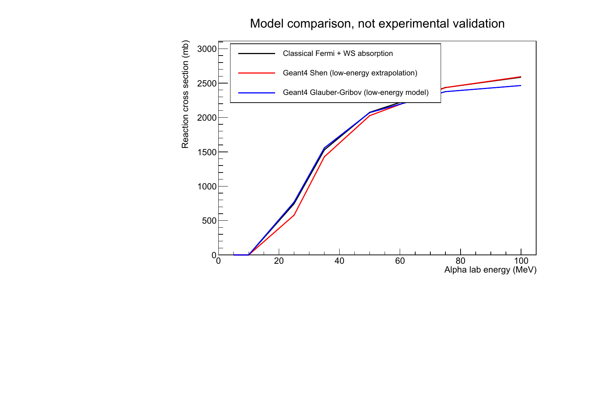

The classical absorption integral and the two Geant4 predictions follow similar
overall energy trends, with the largest relative differences near the barrier.
[Vector PDF](results/nuclear_physics_benchmark.pdf).

## Simulation results

The trajectories are deterministic; the detector histograms use a fixed random
seed and 15,000 events per model.

### Charge distribution

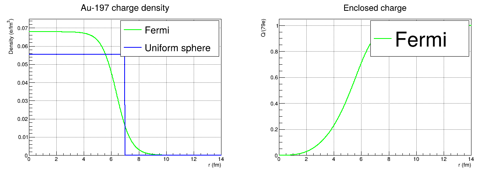

The uniform sphere has a sharp boundary, while the Fermi density falls gradually.
The enclosed-charge fraction approaches unity. Integrating the exported density
to 30 fm gives a total charge of $79e$ to the displayed precision.

### Potential energy

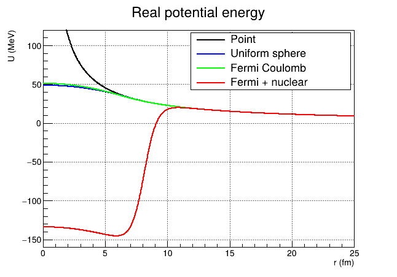

The point potential diverges at the origin. The uniform and Fermi Coulomb
potentials remain finite, reaching 48.88 and 51.18 MeV respectively.
The Woods-Saxon term adds a deep attractive region. The curves show the real
potential; absorption is represented separately by the survival probability.

### Scattering angles

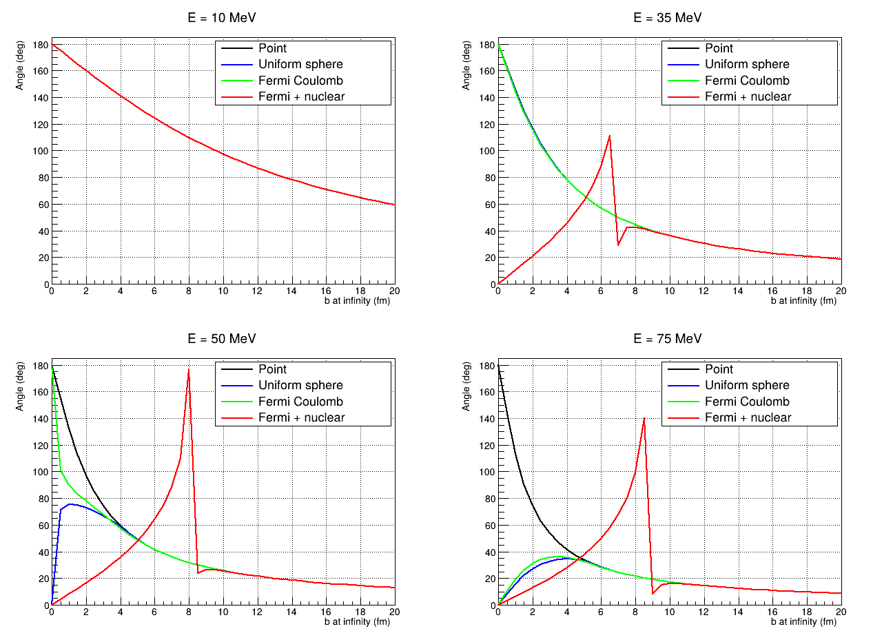

At 10 MeV, the trajectories turn outside the nuclear surface and all four models
approach Rutherford scattering. At 35-75 MeV, the charge profile and nuclear
attraction change the outgoing direction. Sharp features at intermediate impact
parameters arise near grazing or orbiting trajectories, where the scattering
angle is particularly sensitive to the incident conditions.

### Radial forces and attenuation

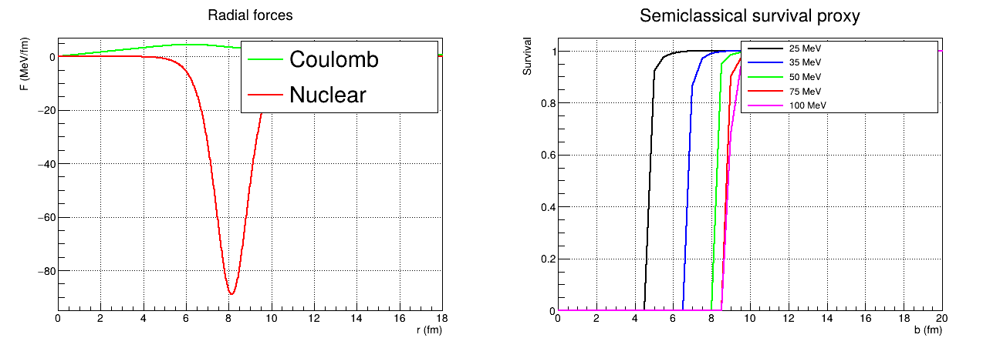

Coulomb repulsion acts outward and nuclear attraction inward. Paths that spend
more time in the region of large $|W|$ acquire smaller survival probabilities,
reducing their contribution to the elastic signal.

### Detector response

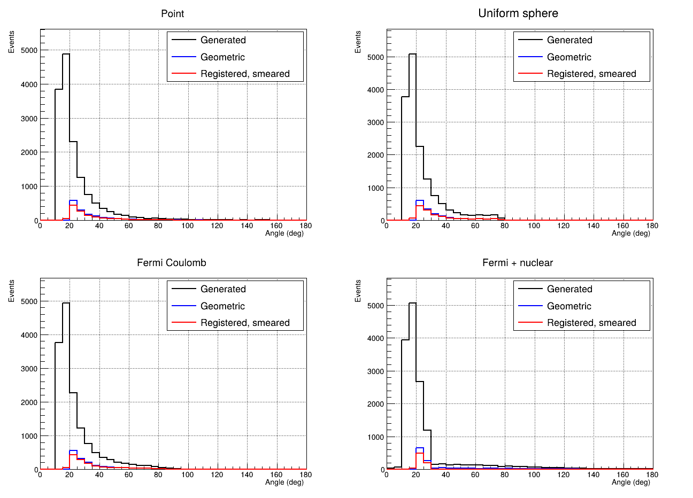

The histograms separate generated directions, geometric acceptance and
registered events. Angular smearing can move a registered value beyond the
acceptance interval that selected its true direction. The vertical scale is
event counts for the stated sample size.

### Resolution and efficiency

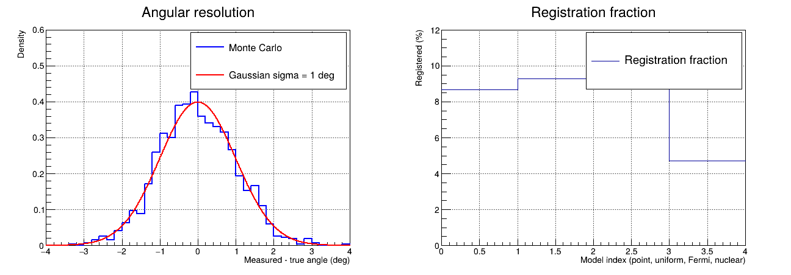

The angular residual follows the imposed $1^\circ$ Gaussian width. The overall
registered fraction includes geometric acceptance and absorption as well as
the 85% registration probability. The corresponding counts are listed in the
model-comparison table.

### Step-size dependence

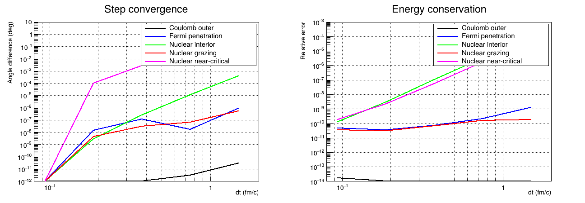

The study uses $\Delta t=1.5,0.75,0.375,0.1875,0.09375$ fm/$c$ and compares
each angle with the smallest-step result. The maximum relative energy error
in the nominal scan is about $9.27\times10^{-7}$. Linear interpolation of the
tabulated force can modify the ideal fourth-order convergence pattern.

The 50 MeV trajectory at $b=8.03816104495$ fm probes a near-critical orbit.
Energy conservation and angular convergence are separate checks in this region;
trajectories approaching a separatrix need progressively finer resolution.

## Geant4 and ROOT comparisons

The independent calculation uses Geant4's `G4CashKarpRKF45` stepper, a custom
equation of motion and adaptive error control. Its eight-component state uses
time in fm/c. The force equations are integrated separately from Geant4's
material-transport engine.

Both implementations use the same fixed nucleus, four interaction models and
detector settings. The Geant4 calculation obtains the Fermi potential from
Simpson quadrature of enclosed charge and exterior shells on a 0.002 fm grid;
the C++ RK4 calculation obtains it by integrating the tabulated force.

The comparison covers 1,148 scan rows and 60,000 incident events. It also follows
24 complete paths at 50 MeV: all four models at
$b=0,1,5,8.03816104495,8.25,15$ fm. Positions and velocities are compared at
common 0.1875 fm/c intervals. The adaptive solver shortens its steps to reach
those times. Maximum position differences are below the 0.02 fm comparison
tolerance; escape-time coverage differs by at most two samples.

| Quantity | Maximum difference |
|---|---:|
| Position along the 24 selected paths | 0.000731565 fm |
| Velocity along those paths | $4.32458\times10^{-6}c$ |
| Final scattering angle | 0.000564158 degrees |
| Survival probability | $1.17108\times10^{-6}$ |

The [ROOT file](data/geant4_model_check.root) contains `scan` and `events`
trees. Model IDs 0-3 correspond to point Coulomb, uniform sphere, Fermi Coulomb
and Fermi + Woods-Saxon.

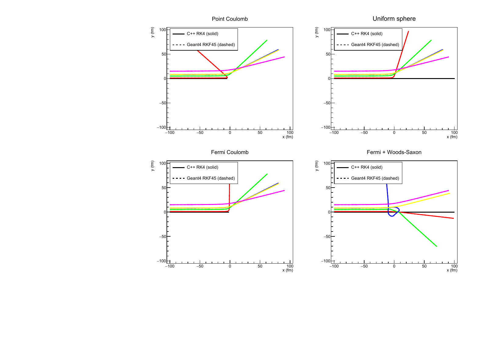

The curves cover head-on, penetrating and grazing paths from entry to escape.
Position and velocity differences are evaluated on the shared time grid.
[Trajectory data](data/trajectory_comparison.csv) |
[Vector PDF](results/trajectory_comparison.pdf).

### Detector distributions

ROOT compares measured angles and energies with identical bins and absolute
counts. Both calculations start from the same incident sample and use independent
random draws for the detector response. For one measured bin, the event
probability is

```math
p_{\rm bin}=A\,P_{\rm survive}\,\varepsilon
\left[\Phi\left(\frac{x_{\rm upper}-x_{\rm true}}{\sigma}\right)
-\Phi\left(\frac{x_{\rm lower}-x_{\rm true}}{\sigma}\right)\right],
\qquad \varepsilon=0.85.
```

Here $A$ is the angular-acceptance indicator, $\Phi$ is the standard-normal
cumulative distribution function, and $x$ is angle or energy. Conditional on the
incident sample, the expected count difference is
$\sum_i(p_{{\rm G4},i}-p_{{\rm C++},i})$, with variance
$\sum_i[p_{{\rm G4},i}(1-p_{{\rm G4},i})+
p_{{\rm C++},i}(1-p_{{\rm C++},i})]$.

The shared incident events make this conditional comparison more appropriate
than treating the two histograms as independent Poisson samples.
Pulls are evaluated for bins with variance at least 10; sparser bins retain
their counts and expectations without a Gaussian significance assignment.
The largest absolute pull is 2.363, below the comparison threshold of 6.
[Bin counts and pulls](data/detector_bin_comparison.csv).

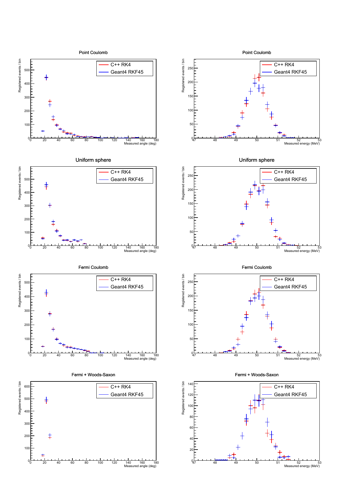

Measured angular and energy distributions for all four models. The common
energy peak follows from fixed-target elastic scattering and the 1% energy
resolution.
[Vector PDF](results/geant4_detector_direct.pdf).

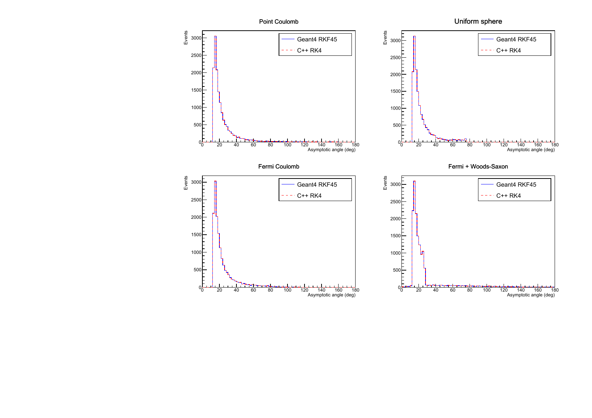

Final true-angle distributions for the matched incident samples.
[Vector PDF](results/geant4_model_angles.pdf).

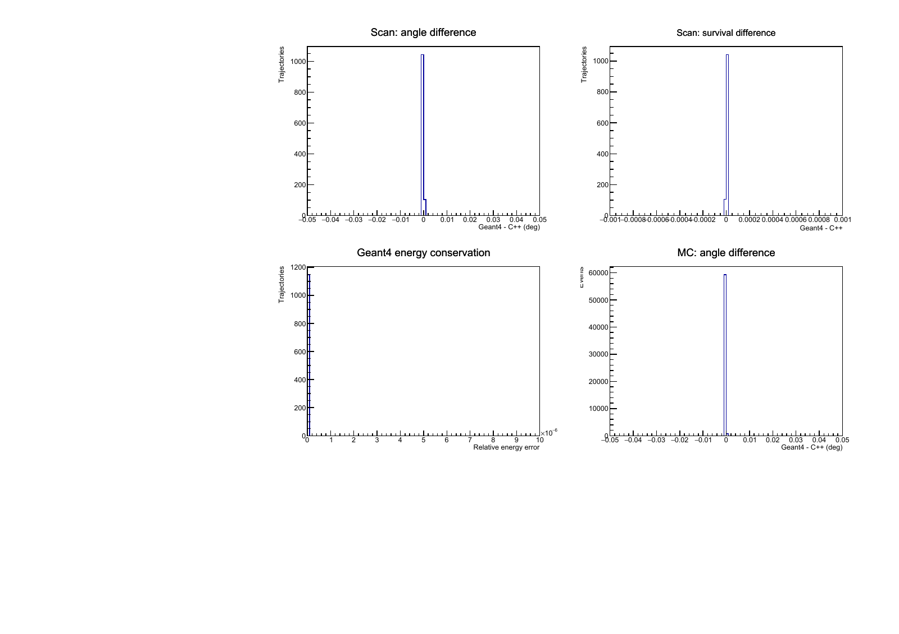

Differences in angle and survival, alongside Geant4 energy-conservation errors.
[Vector PDF](results/geant4_model_errors.pdf).

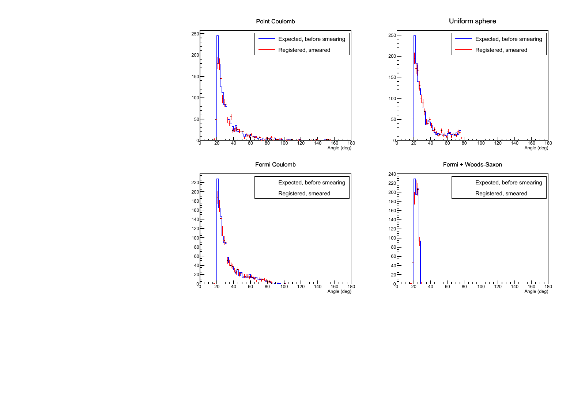

Expected acceptance, survival and efficiency weights compared with registered,
smeared Geant4 events.
[Vector PDF](results/geant4_model_detector.pdf).

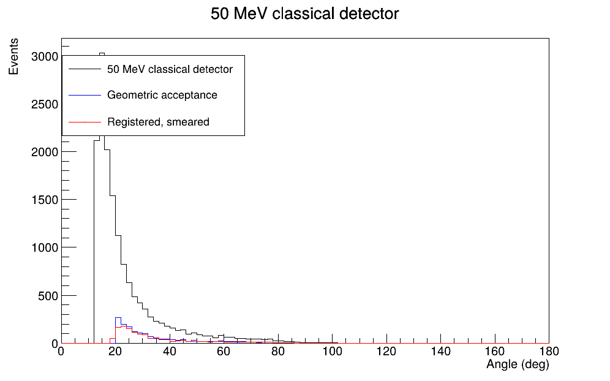

The Fermi Coulomb sample shows how geometric acceptance and registration
change the generated angular distribution.

## Code and data

| File | Content |
|---|---|
| [nuclear_scattering.cpp](nuclear_scattering.cpp) | Standalone C++17 trajectory integrator, numerical Fermi field, real WS potential, event simulation |
| [analysis/plot_nuclear_extension.py](analysis/plot_nuclear_extension.py) | Python plotting code producing seven figures |
| [analysis/validate_results.py](analysis/validate_results.py) | Automated physical and bookkeeping checks |
| [data/fermi_radial_profile.csv](data/fermi_radial_profile.csv) | Charge density, enclosed charge, fields and potentials |
| [data/nuclear_model_scan.csv](data/nuclear_model_scan.csv) | Four-model angle scan, minimum radius, errors and survival |
| [data/nuclear_timestep_convergence.csv](data/nuclear_timestep_convergence.csv) | Step-size comparison |
| [data/detector_events.csv](data/detector_events.csv) | MC generated, accepted, absorbed, registered and smeared events |
| [data/detector_summary.csv](data/detector_summary.csv) | Summary counts |
| [root/analyze_classical.C](root/analyze_classical.C) | ROOT macro reading the classical CSV events |
| [geant4/](geant4/) | Independent Geant4 RKF45 integration of the same four models |
| [root/analyze_geant4.C](root/analyze_geant4.C) | Matched-model ROOT comparisons and detector statistical checks |
| [analysis/test_numerics.cpp](analysis/test_numerics.cpp) | Rutherford, force gradients, starting-radius and timestep regression tests |
| [analysis/plot_with_root.py](analysis/plot_with_root.py) | PyROOT fallback for the seven Python figures |
